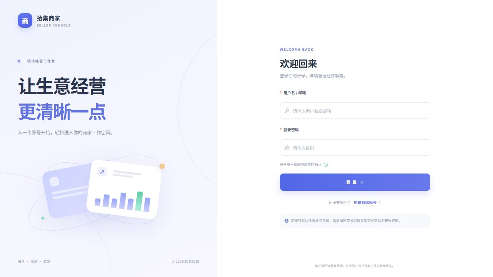
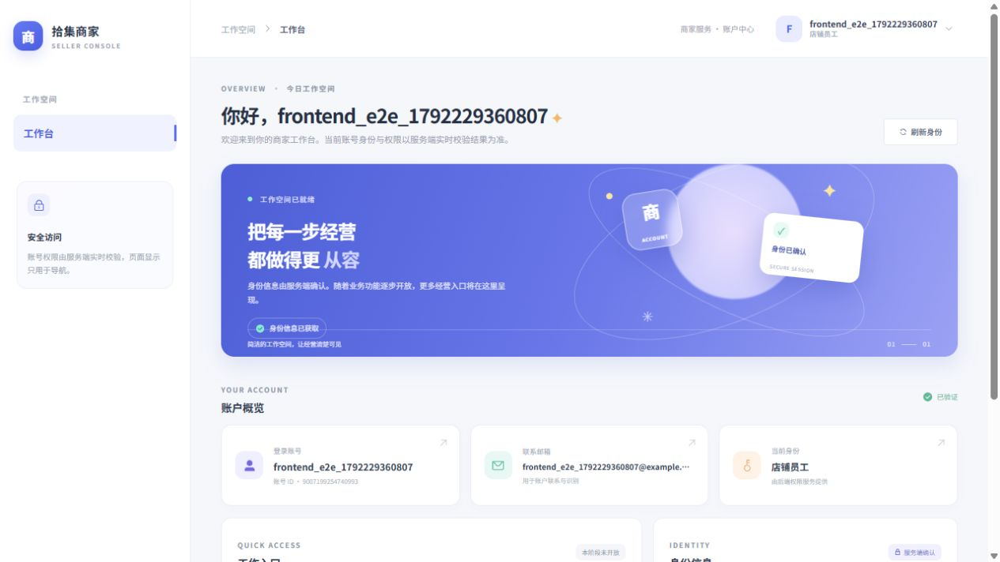

# 电商商家侧前端（第二阶段）

> **2026-10-17 中断记录：用户因额度不足要求暂停。第二阶段尚未完成最终构建、全量测试和审批写入验收；下文第一阶段的12项测试及旧构建数据不能作为第二阶段通过证明。续做请先阅读 [PHASE2_HANDOFF.md](PHASE2_HANDOFF.md)。**

当前交付在第一阶段认证工作台之上增加只面向 `MERCHANT_ADMIN` 的商家工作台。新页面挂在 `/merchant` 下，菜单按已由 `/auth/me` 确认的身份显示；每次进入受保护路由都会重新确认身份。`PLATFORM_ADMIN`、店主、员工和 NONE 账号不能进入商家路由，页面在实时身份变更为非商家管理员后也会退回 403。登录、Pinia、Axios、`json-bigint` 和现有会话错误处理继续共用。

## 第二阶段页面与路由

| 路径 | 页面 | 行为 |
| --- | --- | --- |
| `/merchant` | 商家概览 | 真实商家工作台入口；商家 ID 只读取 `/auth/me`。 |
| `/merchant/profile` | 商家资料 | 仅 `PATCH /merchants/me` 更新名称。后端没有商家资料 GET；初始输入提示为“未读取，请输入新名称”，页面只把 PATCH 响应中的名称当成已确认名称。 |
| `/merchant/shops` | 店铺列表 | 当前商家店铺只读分页列表。 |
| `/merchant/applications` | 审批中心 | 店铺申请与共享仓库授权申请两个队列，支持状态筛选、分页和审批。 |
| `/merchant/orders` | 订单列表 | 只读分页列表，支持状态和店铺筛选。 |
| `/merchant/orders/{id}` | 订单详情 | 只读订单及下单时的商品、规格、数量、单价、小计和总额快照。 |

商家 API 严格限于以下八个已存在的方法路径：`PATCH /merchants/me`、`GET /shops`、`GET /shops/applications`、`POST /shops/applications/{application_id}/review`、`GET /inventory/access-applications`、`POST /inventory/access-applications/{application_id}/review`、`GET /orders`、`GET /orders/{order_id}`。后端业务路由未改动，也没有增加表或 API。契约根据后端 schema/router 和真实 `create_app().openapi()` 核对；本机系统 Python 缺少 `jwt`，OpenAPI 检查使用 `backend/.venv` 执行。订单筛选参数是 `status`、`shop_id`、`limit`、`offset`，分页边界遵循后端 limit 1–100 / offset 0–100000。

审批仅对 `PENDING` 显示操作。批准请求只包含 `decision: "APPROVE"`；拒绝先去首尾空白，必须非空且最多 2000 个 Unicode 码点，提交 `decision: "REJECT"` 与 `rejection_reason`。重复提交由弹窗 loading 和服务端 409 处理；409 显示冲突并刷新列表，不自动重发。共享仓库批准确认页明确说明：“批准代表店铺获得共享仓库使用资格，不等于任意库存修改权。”审批完成后重新读取本页和店铺列表；重新打开页面也会重新请求。仓库授权申请响应没有仓库 ID 或仓库名称；界面只按真实 `shop_id` 尝试关联最近请求的当前商家店铺名称，否则显示店铺编号，不推断仓库信息。

每个业务请求抑制 Axios 全局 toast，由页面映射 401/403/404/409/422/网络错误，避免重复提示。401 由公共 Axios 拦截器清除会话；业务 403 转到权限说明页；详情 404 明确显示“订单不存在，或当前商家无权查看此订单”。身份请求 scope 包含认证 epoch、token、用户 ID、商家 ID 和角色；页面本地请求序号阻止同一租户快速筛选时的旧响应覆盖新筛选。身份变化立即清空页面数据与弹窗；提交、资料响应、列表和订单详情均再次验证 scope 后才允许更新界面。页面还会核对响应中的商家 ID 与 `/auth/me` 当前商家 ID 一致。

所有实体 ID 在解析后校验并规范成正十进制字符串，超出安全范围的已舍入 JavaScript number 会被拒绝。订单数量同样使用十进制字符串；订单金额只接受后端快照字符串，通过 `formatDecimal` 展示，不经 `Number` 重算。后端 MySQL naive `DATETIME` 仅用 `formatNaiveDateTime` 将 `T` 替换为空格，不做时区换算。订单页面没有完成、取消或删除操作。

第二阶段新增代码位于 `src/modules/merchant/`，共享错误/身份/数值基础仍位于 `src/shared/`；Vue Test Utils 与 jsdom 是本阶段加入的开发测试依赖，用于真实挂载审批、路由、分页、只读订单和租户 scope 竞态。Vitest 使用 jsdom 环境。阶段单元测试覆盖商家角色守卫、审批批准/拒绝、Unicode 2000 字符边界、重复提交、仓库授权警示与请求、409 刷新、分页/空状态、订单只读过滤、大整数 ID 与数量、原价字符串、401/409/422 映射，以及商家切换后的迟到资料响应丢弃。

本阶段不把浏览器验收写成代码单测结果。根代理使用与开发后端隔离的专用 API 和 MySQL 执行真实浏览器验收；最终浏览器结论以根代理报告为准。当前代码未自行操作数据库，也没有连接开发 API 进行写入。

---

# 电商商家侧前端（第一阶段）

当前阶段提供 Vue 3 单页应用的基础账号闭环：注册、登录、服务端身份确认、工作台、退出登录、403 和 404。界面使用中文并适配窄屏。本阶段不包含商品、库存、订单等业务页面，也不包含平台管理界面；工作台只显示当前真实身份对应的后续入口说明，不提供未实现页面的死链接。

前端位于仓库根目录的 `Frontend/`，与 `backend/` 并列。项目使用固定版本依赖和 `package-lock.json`。需要 Node.js 24.12 或更新版本以及 npm 11 或更新版本；本阶段已在 Node 24.16.0、npm 12.0.1 环境执行安装和构建检查。

## 本地运行

```powershell
cd backend
.\.venv\Scripts\python.exe -m uvicorn app.main:app --host 127.0.0.1 --port 8000
```

在另一个 PowerShell 终端启动前端：

```powershell
cd Frontend
Copy-Item .env.example .env.local
npm ci
npm run dev
```

默认开发服务器使用 Vite 地址 `http://localhost:5173`。Vite 将 `/api` 请求代理到 `http://127.0.0.1:8000`，不要求后端启用 CORS。可在 `.env.local` 中设置：

```dotenv
VITE_API_BASE_URL=/api/v1
VITE_DEV_PROXY_TARGET=http://127.0.0.1:8000
```

生产部署时，Web 服务器需要将 `/api` 反向代理到后端 API，并为单页应用路由回退到 `index.html`。Vite 开发代理不会自动进入生产构建。环境变量不得放入密钥。

## 路由和认证

| 路径 | 页面 | 访问方式 |
| --- | --- | --- |
| `/login` | 登录 | 未登录 |
| `/register` | 注册 | 未登录 |
| `/` | 工作台 | 需要 token，并在进入时重新读取 `/auth/me` |
| `/403` | 权限或身份关系冲突 | 公开错误页 |
| 其他路径 | 404 | 公开错误页 |

登录成功响应中的 `user` 只有账号基本资料，不包含角色。客户端保存 Bearer token 后立即请求 `GET /api/v1/auth/me`，只有该响应中的角色和租户关系可作为工作台身份显示依据。路由守卫每次进入受保护路由时重新请求身份；后端依旧是授权的唯一来源，前端角色仅用于显示对应入口提示。`PLATFORM_ADMIN` 在本阶段没有管理界面。

token 仅存于 `sessionStorage`，不会写入 `localStorage`。关闭标签页通常会清除其 sessionStorage，但浏览器的会话恢复功能可能恢复标签页状态；本地退出也不会单独吊销服务端 JWT，服务端仍按其过期时间和账号状态验证 token。浏览器存储无法抵御同源脚本注入（XSS）；本阶段没有引入 HttpOnly cookie 会话。401 清除当前本地 token 并回到登录页；陈旧请求的 401 不会清除更新后的会话。`/auth/me` 返回 403 表示身份关系冲突，会清空已展示的身份并转入 403 页；页面可选择退出并重新登录，或返回工作台重新验证。网络或服务错误会隐藏身份内容并允许重试。

登录页支持安全的内部 `redirect` 参数，只接受相同源的应用路径；外部 URL、协议相对 URL、反斜杠路径和认证/错误页会回到工作台默认位置。

## 后端接口契约

契约根据 `backend/app/modules/auth/{router.py,schemas.py}`、`backend/app/api/deps.py`、`backend/app/services/identity.py` 和 `create_app().openapi()` 核对。

| 请求 | 主要响应 | 页面行为 |
| --- | --- | --- |
| `POST /api/v1/auth/register`：`username`、`email`、`password` | HTTP 201：`id`、`username`、`email` | 3–100 位用户名，规则 `^[A-Za-z0-9][A-Za-z0-9_.-]*$`；密码 12–128 位。注册创建基础账号，不自行赋予业务身份。 |
| `POST /api/v1/auth/login`：`identifier`、`password` | HTTP 200：`access_token`、`token_type`、`user` | 用用户名或邮箱登录；成功后必须继续读取身份接口。 |
| `GET /api/v1/auth/me`：Bearer token | HTTP 200：`id`、`username`、`email`、`role`、`merchant_id`、`shop_id` | `role` 为 `PLATFORM_ADMIN`、`MERCHANT_ADMIN`、`SHOP_OWNER`、`SHOP_EMPLOYEE` 或 `NONE`。 |

HTTP 错误集中映射为中文提示：401 登录失效，403 无权访问/身份冲突，404 内容不存在，409 账号冲突，422 字段验证错误，503 服务暂不可用，以及网络错误。认证页抑制 Axios 全局提示，避免同一错误出现重复 toast；422 的 `detail[].loc` 会对应到表单字段。服务器响应的错误消息作为数据处理，不用于执行或渲染 HTML。

## 数值、金额和时间

后端主键是 MySQL BIGINT，并以 JSON 数字发送。Axios 用 `json-bigint` 在默认 `JSON.parse` 前解析响应；`storeAsString` 会将超出安全范围的大整数保留为十进制字符串，安全范围内的小整数仍会解析成 JavaScript `number`。认证适配器校验 ID 为正十进制值后统一转换为字符串；若收到已经舍入的 unsafe `number`，则拒绝该值，不会假装转换后仍然准确。真实浏览器验收确认账号、商家和店铺编号 `9007199254740993`、`9007199254740995`、`9007199254740997` 均完整显示。

业务金额必须使用十进制字符串，展示格式化不得经过 JavaScript `Number`；若小数位超过目标精度且存在非零舍弃位，格式化函数保留原始文本而不静默舍入。后续页面处理数据库 `DATETIME` 时应保留服务端返回的本地墙上时间文本，不得自动转换成 UTC。当前阶段没有业务金额或数据库时间页面。

## 目录

```text
src/
  app/                 路由和应用入口
  modules/auth/        登录、注册、认证 API 与 Pinia store
  modules/dashboard/  工作台和身份概览
  modules/system/      403、404
  shared/http/         Axios 客户端、错误映射、BIGINT/金额/时间工具
  shared/layout/       登录后通用布局
  shared/types/        API 和身份类型
  styles/              全局响应式样式
```

## 必要依赖

| 依赖 | 用途 |
| --- | --- |
| `vue`、`@vitejs/plugin-vue`、`vite` | Vue 3 Composition API、单文件组件与开发/生产构建。 |
| `vue-router` | 单页路由、受保护页面守卫和内部跳转。 |
| `pinia` | 共享认证 token、身份资料和会话状态。 |
| `element-plus`、`@element-plus/icons-vue` | 表单、按钮、提示、下拉菜单及一致的图标组件。 |
| `axios` | 统一 API 请求、Bearer 注入和 HTTP 错误处理。 |
| `json-bigint` | 在 JavaScript 默认 JSON 数字解析发生精度损失前读取 BIGINT。 |
| `typescript`、`vue-tsc`、`@vue/tsconfig` | TypeScript 严格检查 Vue 单文件组件。 |
| `eslint`、`@eslint/js`、`eslint-plugin-vue`、`typescript-eslint`、`globals` | JavaScript/TypeScript/Vue 静态检查。 |
| `vitest` | HTTP、身份适配、数值精度和会话竞争测试。 |

## 检查命令

```powershell
npm run typecheck
npm run lint
npm test
npm run build
```

本阶段执行的结果：ESLint、Vue/TypeScript 类型检查通过；Vitest **5 个测试文件、12 项测试通过**；生产构建通过。当前构建产物约为 JavaScript 1265.35 kB（gzip 403.14 kB）、CSS 381.09 kB（gzip 53.32 kB）。Vite 仍提示主 JavaScript bundle 超过 500 kB；可在后续按页面拆分或按需导入来缩小首屏资源。

## 验收结果

根代理在 Vite `127.0.0.1:5173`、FastAPI `127.0.0.1:8000` 和独立 MySQL 9.7.2 测试库上完成真实浏览器联调。已验证：

- 真实注册、登录、`/auth/me`、页面刷新后的会话恢复、正常退出和根路由守卫。
- 错误密码 401、重复注册 409、后端拒绝的邮箱域名 422 字段提示、空表单前端校验。
- 五种真实身份 `NONE`、`PLATFORM_ADMIN`、`MERCHANT_ADMIN`、`SHOP_OWNER`、`SHOP_EMPLOYEE` 的读取和实时切换。
- 身份关系冲突 403 会隐藏旧身份数据；403 页的“退出并重新登录”可清理本地会话。账号在数据库中被禁用后，原 JWT 访问 `/auth/me` 返回 401，前端会清理本地会话并显示失效提示；前端没有实现 token 主动吊销。
- 不存在路径 404；通过 Vite `/api` 代理访问 health 得到 200，未知 API 得到 404，路径前缀保持正确。
- 超过 JavaScript 安全整数范围的账号、商家和店铺 ID 显示完整。修复图标组件后，浏览器控制台没有 Vue warn/error。

验收使用的隔离测试库和三个临时账号已清理，未写入开发业务库数据。根代理对 101 个 backend 源码、README、配置及迁移文件做了 SHA-256 对比，确认前端工作未修改后端文件；后端没有增加 CORS 设置。

503 与 network 错误映射由单元测试覆盖，但没有在真实浏览器中注入 503 响应或断网故障。没有完成多浏览器、移动设备实机或生产部署验收；全业务页面也不属于本阶段范围。

本次验收后，为便于预览，`127.0.0.1:5173` 的 Vite 开发服务器与 `127.0.0.1:8000` 的后端仍保持运行。浏览器验收中使用过的临时账号已删除，不要把临时凭据写入文档。

## 浏览器验收截图





## 主要文件

```text
package.json, package-lock.json, .env.example, .gitignore, README.md, index.html
vite.config.ts, vitest.config.ts, tsconfig*.json, eslint.config.js
src/main.ts, src/App.vue, src/app/router.ts
src/modules/auth/api.ts, store.ts, pages/LoginPage.vue, pages/RegisterPage.vue
src/modules/auth/api.spec.ts, store.spec.ts
src/modules/dashboard/pages/DashboardPage.vue
src/modules/system/pages/ForbiddenPage.vue, NotFoundPage.vue
src/shared/http/client.ts, errors.ts, precision.ts
src/shared/http/client.spec.ts, errors.spec.ts, precision.spec.ts
src/shared/layout/AppShell.vue, src/shared/types/api.ts, src/styles/main.css
docs/auth-login.jpg, docs/auth-workspace.jpg
```

## 官方参考

- [Vite server.proxy](https://vite.dev/config/server-options#server-proxy)：开发服务器代理规则。
- [Axios error handling](https://axios-http.com/docs/handling_errors)：请求错误及 HTTP 状态处理。
- [Vue Router navigation guards](https://router.vuejs.org/guide/advanced/navigation-guards.html)：全局路由守卫和导航重定向。
