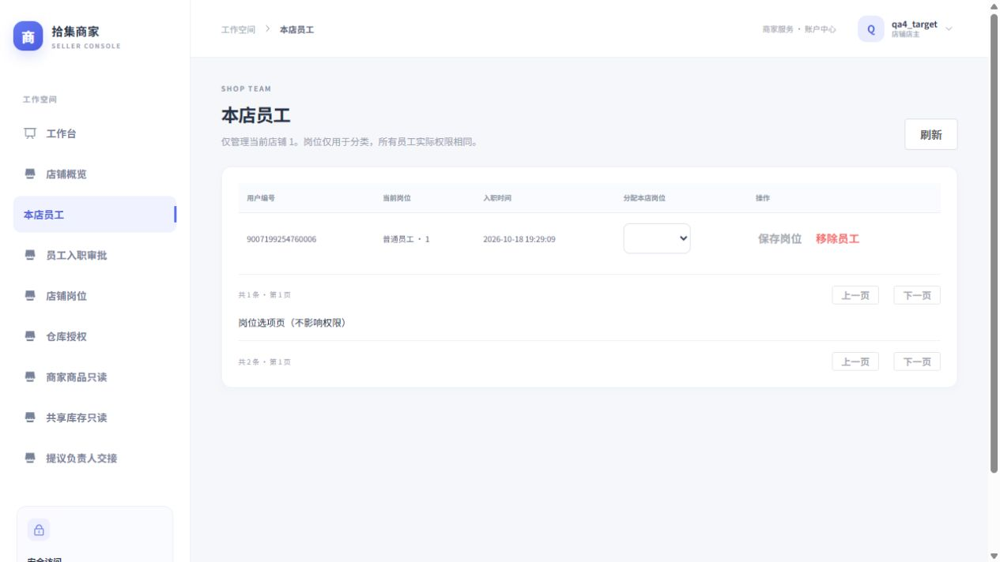
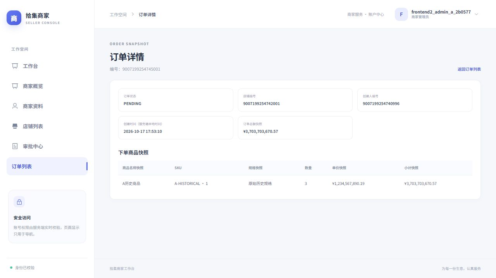

# 电商前端第五阶段交付（2026-10-18）

**店铺负责人和员工订单工作台已完成，本阶段停止。** 以下为本阶段实测结果；后续历史章节仅代表当时状态。DeepSeek 负责实现、测试与浏览器操作，主代理核验并修正代码、执行受控验收；未使用 Luna。

### 1. 交付范围

本阶段实现店主（SHOP_OWNER）与店铺员工（SHOP_EMPLOYEE）两类订单页面：

| 角色 | 路由 |
|---|---|
| SHOP_OWNER | `/shop/orders`、`/shop/orders/create`、`/shop/orders/:id` |
| SHOP_EMPLOYEE | `/employee`（概览）、`/employee/catalog`、`/employee/inventory`、`/employee/orders`、`/employee/orders/create`、`/employee/orders/:id` |

下列 API 统一带 `/api/v1` 前缀。订单页面接入 5 个真实 API：`POST /orders`、`GET /orders`、`GET /orders/{id}`、`POST /orders/{id}/complete`、`POST /orders/{id}/cancel`。创建订单请求体仅含 `items[{sku_id, quantity}]`，并携带 `Idempotency-Key`，不含价格与租户参数。列表响应为 `{items, limit, offset, total}`，查询使用后端支持的状态与分页参数；订单状态为 `PENDING/COMPLETED/CANCELLED`；商品名称、编码、规格、单价、小计与总额使用服务端历史快照，金额保持十进制字符串。

### 2. 关键约束落实情况

- **只读边界**：员工仅可浏览目录与库存，不可管理；商家订单页保持只读。
- **数值与时间**：BIGINT 以精确 JSON 数字传递；数量在单 SKU 上为 `1..9223372036854775807`，单笔订单内 `1..100` 且为不同 SKU；无浮点金额；naive 时间按原文展示。
- **UUID 与幂等**：UUID 仅用于新操作；`sessionStorage` 按 user/merchant/shop 隔离，并保留 unknown 原键、按参数白名单存储，不存 JWT；只有用户明确点击重试时才用原键和原参数 POST，不自动重试。
- **状态回显**：取消订单返回后显示 `CANCELLED`；complete/cancel 结果未知时只做 GET 确认；仅 `PENDING` 状态显示操作按钮。
- **防旧响应**：以 scope epoch/token/user/merchant/shop/role + 序号防止旧响应覆盖；弹窗同样校验。
- **记录丢失处置**：记录丢失时由人工查订单流水，不承诺存储不丢。
- **新增文件**：`orders` 目录 6 个 source（api、pendingOrder、OrderCreatePage、OrderListPage、OrderDetailPage、EmployeeHomePage）与 6 个 spec（orders-api、pendingOrder、OrderCreatePage、OrderPages、roleGuard、EmployeeRead）。
- **修改文件**：router、AppShell、DashboardPage、ShopReadPage、merchant/test-support/elementPlus.ts、README。
- **QA 资产**：脚本 `qa/phase5_env.py`、`qa/phase5_checks.py`；产物 `PHASE5_ACCEPTANCE`、`VERIFICATION`、`HTTP_RESULTS`、`TRIGGER_RECHECK`、`TEST_FIXTURE`、`OPENAPI JSON`；文档三张截图。
- **依赖与后端**：无新增依赖，无 backend 变更，116 处 hash 一致；OpenAPI 与 head `20261017_phase12`（20 tables）一致。

### 3. 构建与测试结果

- lint、typecheck、test、build 全部通过（exit code 均为 0）。
- 测试：26 文件、145 通过、0 失败、0 跳过（原 99 新增 46）。
- Vitest + MemoryRouter 存在不完整路由 warn，实际浏览器 Vue warn/error 为 0。
- 产物大小（括号内为 gzip）：`main` 151.63 kB（51.43 kB）；含 preload 初始 JS 427.73 kB（上阶段 424.80 kB）；CSS 390.02 kB（55.15 kB，不变）；`store` 153.22 kB、`table` 94.53 kB；`create` 21.05 kB（7.19 kB）、`detail` 11.35 kB（4.13 kB）懒加载。未调高阈值。

### 4. 真实 MySQL 与 HTTP 验证

- 真实 MySQL 目标 `orders, orders_migrations, phase12`：首次 15 pass / 2 fail，原因为 MySQL 1419 触发器 SUPER 权限；受控本机管理连接仅在临时库重跑两例（2 pass），不改全局设置；最终 17 unique 通过。此为订单相关验证，非 backend 全量。
- 13 组 HTTP 通过：共享库存/隔离、抢 1 库存 201+409、取消回补 1、multiSKU 回滚、改价下架历史保持、旧 JWT 移除失权、再入职、交接等。
- 浏览器验证：店主创建与完成；员工未知重试显示 cancelled；complete/cancel 实际成功但丢响应后经 GET 确认；未授权库存 403 且保留身份；移除旧 JWT 后导航 403；晋升新 shop 不显示旧订单。
- 代理验证：同 UUID 两次 POST，两次请求后端均返回 201；代理向浏览器先返回 503、再返回 201，两次请求参数 SHA 相同；仅 order 6 一单 1 扣减 1 回补；complete/cancel 各仅 1 次 POST。
- 环境清理：MySQL 9.7.2 隔离库（8 users、2 merchants、4 shops）库账号已删；端口 8018/8019/6179 已关闭；浏览器已关闭；开发库未改。另有 Starlette 弃用 warning。

截图：`docs/phase5-order-completed.png`、`docs/phase5-order-replay.png`、`docs/phase5-order-cancelled.png`。

### 5. 未覆盖项

未跑 backend 全量，未做生产/跨浏览器全窄屏矩阵。

---

## 停止记录

阶段 5 完成并停止。验收依据：lint/typecheck/test/build 全通过（145 通过，0 失败）；订单相关真实 MySQL 17 unique 通过；13 组 HTTP 通过；浏览器与代理核验通过；无新增依赖，无 backend 变更，OpenAPI 一致。已清理隔离库与端口。未跑 backend 全量与全窄屏矩阵，记录丢失仅可人工查订单流水。
### 6. 文件定位与验收证据

新增源码（均位于 `src/modules/orders/`）：`api.ts`、`pendingOrder.ts`、`OrderCreatePage.vue`、`OrderListPage.vue`、`OrderDetailPage.vue`、`EmployeeHomePage.vue`。测试为 `src/modules/orders/__tests__/orders-api.spec.ts`，以及 `src/modules/orders/` 下的 `pendingOrder.spec.ts`、`OrderCreatePage.spec.ts`、`OrderPages.spec.ts`、`roleGuard.spec.ts`、`EmployeeRead.spec.ts`。

修改文件：`src/app/router.ts`、`src/shared/layout/AppShell.vue`、`src/modules/dashboard/pages/DashboardPage.vue`、`src/modules/workspace/pages/ShopReadPage.vue`、`src/modules/merchant/test-support/elementPlus.ts`、`README.md`。另新增本阶段 QA 脚本、JSON 证据、截图及 [停止记录](PHASE5_HANDOFF.md)。QA 脚本复用本机 MCP 的受控临时库工具，不是应用运行依赖；响应丢失代理只用于测试，不提供新业务 API。

- [真实 OpenAPI 快照](PHASE5_OPENAPI.json)、[前端与清理核验](PHASE5_VERIFICATION.json)。
- [13 组 HTTP 验收](PHASE5_ACCEPTANCE.json)、[浏览器请求及响应丢失代理记录](PHASE5_HTTP_RESULTS.json)。
- [两项触发器故障注入复测](PHASE5_TRIGGER_RECHECK.json)、[已清理测试环境信息](PHASE5_TEST_FIXTURE.json)。
- 完整工具日志在本机 MCP runs：前端检查 `5997d3906ed64af9a75f6a7030802278`，首次目标后端测试 `4573c81577b54a07873625f300197d01`。

### 7. 权限、异常与后续边界

店主和员工可操作本店订单，包括本店其他员工创建的订单；商家管理员保持现有只读权限。前端守卫每次受保护导航重新获取真实身份，服务端继续裁决所有授权。员工不提供分类、SKU、库存调整、人员或审批管理入口。商品与库存复用现有只读 API，不新增公开店铺查询；订单创建只选择 ON_SALE 商品，实际库存和价格由下单事务决定。

列表与详情包含加载、空数据、重试和分页；401 处理登录失效，403/404 显示真实访问错误，409 保留业务冲突反馈，422 显示输入错误，503/网络中断按写请求结果未知处理。创建结果未知时冻结原参数；完整确认后才允许开始下一笔。完成或取消需要确认，成功后重查订单与库存；结果未知只读取状态，避免重复写操作。员工仓库资源返回 403 时显示申请授权说明，不擅自把有效员工身份清空。

自定义岗位不影响订单权限；不信任 JWT 中永久保存的身份，也不信任客户端租户字段。历史订单展示快照，不从当前商品信息重建；商品改价或下架不改变已生成订单。本阶段未开发平台管理、支付、物流、订单删除或员工管理新功能。

剩余风险：浏览器关闭、存储清理或存储损坏仍可能丢失待确认记录；缺少按请求键查询的独立 API 时必须人工核对历史订单/流水，不得直接认定失败后换键重下。共享 Element Plus CSS 仍较大；未验证生产部署、所有移动端尺寸及跨浏览器矩阵。若继续下一阶段，先审核上述交付与存储恢复体验，再明确范围；本次不自动扩展。


---

# 电商前端第四阶段交付（2026-10-18）

**第四阶段 4A 身份申请、4B 店铺负责人工作台、4C 正常及强制交接已完成，验收资源已清理，本阶段停止。** 复用现有 Vue3/TypeScript、Pinia、Axios、认证、精确 JSON 和角色守卫；没有新增依赖，没有修改后端业务、数据库结构、历史迁移、CORS 或开发环境配置。下方第三阶段及更早内容保留为历史交付，不应混淆不同阶段的测试结果。

## 页面、路由与开放身份

| 路径 | 身份 | 内容 |
| --- | --- | --- |
| `/applications` | NONE | 商家入驻、商家目录与开店申请、手工填写店铺 ID 的员工申请；个人记录、状态筛选、分页、刷新真实身份。 |
| `/shop` | SHOP_OWNER | 当前店铺概览与已实现功能导航。 |
| `/shop/employees` | SHOP_OWNER | 本店员工分页、从本店岗位页选择岗位、保存后重查关系、移除二次确认。 |
| `/shop/applications` | SHOP_OWNER | 本店入职申请、状态筛选、批准及驳回；驳回原因去空白后 1–2000 字符。 |
| `/shop/roles` | SHOP_OWNER | 本店岗位分页与创建；名称去空白后 1–100 字符，不提供编辑或删除。 |
| `/shop/warehouse` | SHOP_OWNER | 本店仓库使用申请与状态、分页；不指定仓库或店铺 ID。 |
| `/shop/catalog` | SHOP_OWNER | 所属商家的分类、SPU 分页、SPU/SKU 详情只读。 |
| `/shop/inventory` | SHOP_OWNER | 获授权后的商家共享仓库及库存分页只读。 |
| `/shop/owner-transfer` | SHOP_OWNER | 提议负责人交接、真实 proposal_id UUID 展示与复制。 |
| `/merchant/owner-transfer` | MERCHANT_ADMIN | 本商家店铺分页，确认店主提供的 UUID，或填写原因并二次确认 FORCE。 |

全部新增业务页按路由懒加载，复用现有布局。平台管理员没有新增前端管理页；员工保留身份工作台，完整员工订单工作台未开发。

## 真实 API 契约

运行中的 FastAPI `/openapi.json` 与 [本阶段快照](PHASE4_OPENAPI.json) 完全一致。下列路径均以 `/api/v1` 开头，不新增任何后端 API。

| 方法与路径 | 请求与响应要点 |
| --- | --- |
| `GET /merchants` | 分页商家目录，只消费 `id/name`，不公开店铺搜索接口。 |
| `POST/GET /merchants/applications` | 创建 `{merchant_name}`；返回申请 ID、申请人、名称、状态、审核信息、结果商家 ID 和时间；GET 分页与状态筛选。 |
| `POST/GET /shops/applications` | 创建 `{merchant_id, shop_name}`；返回真实商家、申请人、店名、审批信息及结果店铺 ID；GET 是个人或商家权限范围。 |
| `POST/GET /employees/applications` | 创建 `{shop_id}`，不传申请人或角色；GET 为本人或当前店主本店范围，返回申请与审批信息。 |
| `POST /employees/applications/{id}/review` | `{decision:"APPROVE"}` 或 `{decision:"REJECT", rejection_reason}`；返回真实申请状态。 |
| `GET /shops` | 复用当前身份的数据范围；读取 `id/name/merchant_id/owner_user_id/created_at`。 |
| `GET /shops/{shop_id}/employees` | 员工关系分页：`id/shop_id/user_id/role_id/role_name/joined_at`。 |
| `DELETE /shops/{shop_id}/employees/{user_id}` | 成功 **204 无 JSON**；只解除在职关系，不删除账号和历史。 |
| `GET/POST /shops/{shop_id}/employee-roles` | GET 岗位分页；POST 只传 `{name}`，返回本店岗位 ID、名称及时间。 |
| `PATCH /shops/{shop_id}/employees/{user_id}/role` | 只传 `{role_id}`；返回服务端真实员工关系，随后重查列表。 |
| `POST/GET /inventory/access-applications` | POST **严格空 JSON `{}`**，服务器推导店铺及商家仓库；GET 返回申请、状态、审批信息及时间，支持分页。 |
| `GET /inventory/warehouse`、`GET /inventory/stocks` | 复用第三阶段适配器，读取真实仓库和 SKU 库存；店主页面没有人工调整入口。 |
| `GET /catalog/categories`、`GET /catalog/spus`、`GET /catalog/spus/{id}` | 复用商品精度与归属适配器，只读所属商家的商品及 SKU。 |
| `PUT /shops/{shop_id}/owner` | 唯一交接接口，三种 action 见下文；不虚构 GET proposal 或待交接列表。 |

分页统一 `{items, limit, offset, total}`，本阶段页大小 20，使用后端 `limit=1..100 / offset=0..100000` 边界。申请状态为 PENDING、APPROVED、REJECTED。正常申请名称去空白后 1–255 字符。前端不发送 `applicant_user_id`、审核人、身份、权限等非开放字段。

## 身份申请、员工和仓库边界

新账号必须经审批建立真实业务关系。提交申请只展示服务器返回的状态，不自行写入商家管理员、店主或员工身份；用户主动刷新时重新调用 `/auth/me`。NONE 无法提前进入 `/merchant` 或 `/shop`。

岗位只是分类名称，所有员工实际业务权限一致。页面不创建动态 permissions 配置，不因“销售专员”等名称改变角色或菜单。岗位下拉只展示当前本店岗位分页，后端进一步拒绝跨店角色 ID。移除员工要求确认，204 成功后重新读取列表；员工可以按正常流程重新申请。

仓库授权由当前店主向所属商家的唯一仓库申请，不能客户端选另一店或仓库。未授权库存请求的 403 在当前页面说明并提供授权申请入口，**不直接断言店主身份失效**；可另行刷新 `/auth/me` 核对身份。批准前不显示虚构库存。批准只授予使用资格，不授予店主人工库存修改权限。商品管理、SKU 和库存写入口仍只在原商家管理模块提供。

## 正常交接与 FORCE

- 店主 PROPOSE：`{action:"PROPOSE", target_user_id}`。返回 `status:"PROPOSED"`、当前负责人、目标和 `proposal_id`；页面说明尚未交接，支持复制 UUID，失败时可手动复制。不猜用户名、不调用不存在的用户搜索或 proposal 查询接口。UUID 仅保留在当前身份页面内存，刷新、离开或身份切换后不虚构待交接记录。
- 商家管理员 CONFIRM：`{action:"CONFIRM", proposal_id:"UUID"}`。只选择真实返回的本商家店铺；确认成功后重查 `/auth/me` 和店铺列表。失效、未知或重放提议由后端返回 409，前端显示冲突，不宣称成功。
- 商家管理员 FORCE：`{action:"FORCE", target_user_id, reason}`。原因去空白后 1–2000 字符，独立操作选项、危险按钮和二次确认；明确不是旧负责人同意，旧权限撤销且原员工岗位不会自动恢复。

服务端确认成功后才展示交接成功。随后身份刷新失败会提示“已成功但刷新失败，不要重复交接”，不能伪装成业务回滚。新旧身份和原岗位恢复都以各自 `/auth/me` 与员工关系为准。浏览器实际完成“岗位员工晋升店主 → 正常交回 → 恢复原销售专员岗位”以及 FORCE 撤权；原仓库授权仍属于店铺，不因交接消失。

## 精度、异步请求和权限隔离

ID 统一为无损十进制字符串，沿用 JSON-BIGINT 解析。在创建开店/员工申请、分配岗位及交接目标等写请求中，使用已有 `stringifyApiJson` 将 BigInt 写成精确 JSON 数字；测试验证超过 2^53 的原始请求 body，不以 Number 转换 ID。输入 ID 为正十进制整数并拒绝超过 signed BIGINT 的值。SKU 金额沿用 decimal 字符串格式化，不做浮点运算；naive DATETIME 保留原始本地墙上时间文本。

新增 identity scope 含 epoch、token、用户 ID、商家 ID、店铺 ID、真实 role；变化时同步清空旧列表、表单、弹窗与 UUID，过期异步响应不能回写。相同 scope 的分页/筛选也用请求序号丢弃乱序结果。每次受保护导航重新确认身份；路由仅作体验控制，最终隔离由后端真实数据库关系裁决。返回其他申请人、其他店铺或商家的记录也不会展示。

真实联调修复了角色变化期间框架跳转和守卫 `/me` 刷新互相触发的导航循环；跳转保护在旧框架生命周期内只触发一次，并补实际 Pinia store + Router 的回归。刷新列表前清除旧数据，因此权限失效后的失败查询不会继续展示旧仓库、商品或员工。登录失效提示所需 ElAlert 改为显式导入，解决实际浏览器发现的未注册组件警告。

页面提供加载、空状态、分页、失败重试、成功反馈、表单校验和重复提交保护。401 复用全局清会话与登录失效提示；403 区分身份冲突和资源资格；404/409/422、503 与网络错误使用已有 ApiError/字段映射。刷新数据的重试不自动重发业务写入；本阶段没有宣称所有写 API 都具备库存式幂等保证。

## 实际文件变更

相对第四阶段开始时的84文件前端基线，修改8个已有文件：

- `src/app/router.ts`、`src/app/router.spec.ts`
- `src/shared/layout/AppShell.vue`、`src/shared/layout/AppShell.spec.ts`
- `src/modules/dashboard/pages/DashboardPage.vue`
- `src/modules/auth/pages/LoginPage.vue`
- `src/styles/merchant.css`
- `README.md`

新增实现与测试：

- `src/modules/workspace/api.ts`、`api.spec.ts`：真实契约、精确 ID 写入、204 与交接 action 白名单。
- `src/modules/workspace/useIdentityScope.ts`：店铺和 NONE 作用域、过期响应检查与业务错误说明。
- `src/modules/workspace/RoleFrame.vue`、`RoleFrame.spec.ts`：角色工作区、路径重建、身份刷新跳转竞态回归。
- `src/modules/workspace/components/PageButtons.vue`：统一分页和后端 offset 上限。
- `src/modules/workspace/pages/ApplicationsPage.vue`：三类申请及个人记录。
- `src/modules/workspace/pages/ShopPeoplePage.vue`：本店员工、审批与岗位。
- `src/modules/workspace/pages/ShopReadPage.vue`：概览、仓库申请、商品与库存只读。
- `src/modules/workspace/pages/OwnerTransferPage.vue`：PROPOSE、CONFIRM、FORCE。
- `src/modules/workspace/pages/workspace.spec.ts`：25项页面行为回归。

验收与记录：`qa/phase4_env.py`、`PHASE4_TEST_FIXTURE.json`、`PHASE4_HTTP_RESULTS.json`、`PHASE4_OPENAPI.json`、`PHASE4_REQUEST.md`、`PHASE4_HANDOFF.md`、前后端基线两个 JSON，以及 `docs/phase4-employees.png`、`docs/phase4-owner-transfer.png`。没有改 package.json、锁文件或 .env。历史阶段未提交的改动保留，没有重置或覆盖。

## 实际测试与浏览器验收结果

| 检查 | 最终结果 |
| --- | --- |
| `npm run lint` | 通过，0 error、0 warning。 |
| `npm run typecheck` | 通过。 |
| `npm test` | **20文件、99项全部通过**；此前60项保持通过，本阶段新增39项有效行为测试。 |
| `npm run build` | 通过，无500 kB chunk警告，未提高警告阈值。 |
| 真实 MySQL + FastAPI | MySQL **9.7.2**；专用库完整升级至 **20261017_phase12**、20张业务表；实际 OpenAPI 与快照相等；**20组 HTTP/数据库断言通过**，详见 [结果](PHASE4_HTTP_RESULTS.json)。 |
| 真实浏览器 | 普通用户注册、三类申请；商家审批后真实身份变化；员工批准、岗位创建分配、204移除和再次申请；仓库403留页、申请及批准后零库存只读；商品及精确19.90价格只读；正常双向交接、原岗位恢复、FORCE二次确认与旧JWT撤权；最终店主和管理员会话无Vue error/warn。 |
| 错误路径 | 浏览器真实验证401失效跳转、未授权403、重复申请409；HTTP验证404/409/422，组件测试验证422字段提示和交接失败不显示成功。没有把422的HTTP/组件检查写成浏览器注入验收。 |
| 资源和开发数据 | 专用库 `test_frontend_phase4_95969cd7` 与9个测试账号、全部数据已删除，查询确认库不存在；API8016、Vite6176已停止且无监听；3个测试浏览器会话已关闭；116个后端基线SHA256全部未变。 |

本阶段先用真实 DeepSeek MCP 审查设计和代码，再由主代理独立核对、修改和执行验收；没有使用 Luna。DeepSeek 不读取文件或执行命令，没有接收密码、JWT或密钥。初次草案中不符合真实接口的建议没有采用。

验收 helper 从原有 Settings 在进程内读取连接信息，只允许本次 `test_frontend_phase4_` 随机专用库。临时测试密码只经 `PHASE4_PASSWORD` 环境变量提供，JWT和密码不写报告。该脚本不是可直接重跑的完整浏览器自动化套件：`checks` 依赖 README 记录的浏览器正常双向交接和 FORCE 后置状态；再次验收须显式创建新库、准备fixture并重新执行浏览器流程，不复用旧PID或已删除库。

## Bundle 与残留限制

最终主 JS **148.75 kB（gzip50.64）**；按 dist/index.html 直接入口和 modulepreload 统计的初始 JS 合计 **424.80 kB**，前一阶段415.93 kB，增加约8.87 kB。新增懒加载页：Applications6.77、ShopPeople9.76、ShopRead9.85、OwnerTransfer8.07 kB；共享模块由 Vite 自动拆分。Element Plus 表格、选择器、弹窗/消息框分离为公共 chunk；保留原有完整样式表，CSS **390.02 kB（gzip55.15）**，没有为消警告调高阈值。主chunk大小不等于首屏总传输量，初始公共依赖和CSS仍有优化空间。

尚未运行完整后端 Pytest（本阶段未改后端），没有生产部署、移动实机或跨浏览器兼容性验收。自动化覆盖了分页、乱序与scope变更，浏览器使用小型fixture，不把数十页人工翻页或真实移动端验收声称已完成。窄屏样式保留横向表格滚动与可折行表单，但长期可改进菜单体验和样式按需加载。

当前没有公开用户搜索和proposal查询API；手输目标ID/UUID是已确认限制，不能凭前端缓存预测资格。身份在服务端变化后，通过下一次身份验证/受保护导航确认，不提供实时推送。独立审计继续由后端业务提交后另事务写入，不能保证事件绝对不丢失。下一阶段可单独评审店主/员工订单工作台；本次未开发该阶段、平台管理或其他新业务。

真实验收页面截图：



[负责人交接验收截图](docs/phase4-owner-transfer.png)

---

# 电商商家侧前端（第三阶段交付）

状态：**第三阶段 3A 商品目录与 3B 共享库存管理均已完成，最终检查通过，隔离验收资源已清理。** 本阶段在第二阶段商家工作台上增加商品与库存管理，仅对服务端确认的 `MERCHANT_ADMIN` 开放。分类、SPU、SKU、库存和申请流水都按当前商家隔离；没有新增后端接口、表、迁移或运行依赖。第二阶段原始交付记录见下方“第二阶段历史交付”，第一阶段认证说明继续保留在文末。

## 第三阶段页面与路由

| 路径 | 页面 | 行为 |
| --- | --- | --- |
| `/merchant/catalog` | 商品管理 | 分类分页与创建；SPU 分页、筛选、创建、详情和编辑；SKU 创建与编辑；有 SKU 才能请求上架；销售中的商品只能提交下架申请，查看申请状态和历史。 |
| `/merchant/inventory` | 库存管理 | 查看商家仓库、SKU 库存和库存流水；用非零整数执行人工库存调整；显示服务端确认的库存操作结果。 |

两页使用商家路由守卫和懒加载，只在 `MERCHANT_ADMIN` 导航中显示。商品状态只能通过独立的 `PATCH /catalog/spus/{spu_id}/publish` 上架；普通 SPU `PATCH` 的请求体只包含 `category_id`、`name`、`description` 白名单字段。SKU 价格始终保留为 decimal 字符串，不经 JavaScript 浮点数转换。商品至少有一个 SKU 才开放上架操作；下架操作只提交平台审核申请，不提供平台审核页或删除入口。

本阶段调用 15 个既有 API：

| 模块 | 方法与路径 |
| --- | --- |
| 商品 | `GET/POST /catalog/categories`、`GET/POST /catalog/spus`、`GET/PATCH /catalog/spus/{spu_id}`、`PATCH /catalog/spus/{spu_id}/publish`、`POST /catalog/spus/{spu_id}/skus`、`PATCH /catalog/skus/{sku_id}`、`GET/POST /catalog/offshelf-applications` |
| 库存 | `GET /inventory/warehouse`、`GET /inventory/stocks`、`GET /inventory/movements`、`POST /inventory/operations` |

分类和商品列表遵循后端分页边界 `limit=1–100`、`offset=0–100000`。商品筛选使用真实 `category_id`、`status` 参数。库存操作的流水中，`idempotency_key` 与 `order_item_id` 都可能为 `null`，界面按空值显示；订单流水不会被错误地当成人工库存调整。

## 第三阶段精度、重试与身份隔离

所有实体 ID 进入界面状态后都是十进制字符串。后端的 `StockOperationRequest.sku_id` 是严格整数，操作请求用 `json-bigint` 的 BigInt 序列化器把超过 `2^53` 的 ID 写成精确 JSON 数字；分类和下架申请中的 ID 也按同一方式精确写入。API 测试检查了超安全整数 SKU 请求的原始 JSON body。接收响应时仍由 `json-bigint` 在 `JSON.parse` 前解析整数；已舍入的 unsafe JavaScript `number` 会被拒绝。

价格以十进制字符串保存和显示，表单最多接受 10 位整数和两位小数，与后端 `DECIMAL(12, 2)` 边界一致。库存数量使用精确整数文本显示；人工 delta 必须是非零安全整数，拒绝小数和超出 JavaScript 安全整数范围的输入，再由后端校验 BIGINT 和非负库存边界。

每笔人工调整在发送前生成 UUID 幂等键，并在浏览器 `sessionStorage` 的 `user_id + merchant_id` 独立命名空间保存键、SKU、delta、状态和必要响应字段，不保存 token。请求忙时禁止重复提交。网络错误或 HTTP 5xx 会标记为“结果未知”、保留原键和参数，并阻止另建库存操作；页面不会自动重发。用户先可刷新真实库存和该 SKU 最近 100 条流水：若流水包含同一 key，页面还会核对 SKU、delta、操作人和商家；未找到时仍然保持未知，因为当前接口无法证明该记录不存在。用户明确选择重试时，前端复用原 UUID。核对时的 100 条临时结果仅用于匹配，随后重新查询原分页的 20 条库存和未筛选流水，不会把临时单 SKU 查询混入主列表。明确的业务失败会显示服务端错误并刷新库存和流水；成功响应会标记为已确认并重新读取两类数据。

导航离开或刷新不会静默丢弃未知操作，按同一身份返回时可以继续核实。身份 scope 变化会立即清空页面数据、筛选和弹窗；用户或商家改变后只读取新身份对应的存储命名空间，不会把旧租户的 key 展示给新租户或替其重试。旧身份的异步响应与错误在作用页面前再次检查 scope；列表请求还用序号丢弃同一租户中过期筛选的迟到响应。页面映射 401、403、404、409、422、503 及网络错误，不重复触发 Axios 全局 toast。

## 第三阶段真实验收

根代理在专用 MySQL 9.7.2 测试库与浏览器中执行隔离验收；开发库没有用于这些验收写入。API 真实检查确认：超 2^53 的 SKU ID 以 JSON 数字请求成功；把该 ID 作为 JSON 字符串会得到 422；相同 key 与 payload 重试只产生一条流水并重放原响应；同 key 换参数和库存不足返回 409；delta 为零返回 422；普通 SPU PATCH 的 `status` 被拒绝；跨商家商品和人工库存写入按后端返回 404；店主、员工、NONE 与平台管理员进行人工库存调整均返回 403。两个授权店铺读取同一共享库存。

真实浏览器中，商品页只显示 A 商家数据；A 新建分类、SPU、SKU，精确编辑大额价格，完成上架、下架申请提交、申请状态历史和重新上架。无 SKU 商品不能上架；下架申请提示说明商品不会被直接删除或下架，获批后 SKU 仍保留。库存页验证正负调整、库存成功刷新、过期库存调整的 409 业务反馈，以及代理在后端提交后伪装 503 时的未知结果处理：页面刷新后保留原 UUID 和参数，用户明确复用同 key 后库存只增加一次且只有一条对应流水。第二笔丢失响应的操作通过真实库存流水核对成功确认，无需重新提交。B 商家的商品、仓库、库存和流水不包含 A 的数据；店主、员工、NONE 与平台管理员直接访问商家业务页面均被拒绝。禁用 B 账号后，库存刷新返回 401 并清除登录状态；临时移除 A 的管理员关系后，旧页面的库存写入返回 403，并在跳转前清理该明确失败操作的存储记录。恢复测试关系后重新进入，表单没有残留未知操作。旧商家资料、店铺、两类审批和订单页面完成读取回归，浏览器 Vue console warn/error 为空。

错误反馈验收中，库存 409 来自真实库存被并发操作减少后再次扣减；503 来自测试代理在真实后端提交成功后丢弃成功响应。为验证通常会被前端校验拦住的服务端错误，另通过临时代理把分类请求改为空名称，获得真实 FastAPI 422 响应，确认表单保持可修正；把详情查询转向不存在的资源得到真实 404，确认持续错误和同商品 ID 的重试恢复。上述故障代理只用于隔离验收，不属于产品或后端代码，现已停止并删除临时开关和日志。

验收截图：[商品目录](docs/phase3-catalog.jpg)、[商品详情与精确价格](docs/phase3-catalog-detail.jpg)、[共享库存总览](docs/phase3-inventory.jpg)。

专用库 `test_frontend_phase3_2015f19e` 已核对库名、迁移版本、8 个测试账号前缀及 2 商家/3 店铺的归属后删除，并确认不存在；任务 API8013、故障代理8014、Vite6173 均已停止，测试端口没有残留监听。真实开发库和其他项目数据库没有写入。后端 116 个基线文件 SHA-256 全部保持一致。`PHASE3_TEST_FIXTURE.json` 已标记 `cleaned`，仅保留非秘密历史元数据，旧 PID 和库名不是可用环境。

## 第三阶段检查结果

根代理对冻结源码独立执行 `npm run lint`、`npm run typecheck`、`npm test`、`npm run build`，均通过：ESLint 0 warning，Vue/TypeScript 检查通过，Vitest **17 个测试文件、60 项测试通过**，生产构建成功。没有运行完整后端 pytest 套件；后端源码、配置和迁移没有修改。

生产构建的主 JavaScript chunk 为 135.18 kB（gzip 46.41 kB），Catalog 页面为 30.19 kB（gzip 9.64 kB），Inventory 页面为 16.20 kB（gzip 5.78 kB）。初始 HTML 还预加载 store（153.21 kB）、icon（62.16 kB）、scrollbar（56.18 kB）和 message（9.20 kB）公共 chunk，初始 JavaScript 合计约 415.93 kB；表格、选择器和对话框分别拆为 103.57 kB、35.18 kB 和 11.64 kB chunk。CSS 为 388.12 kB（gzip 54.79 kB）。构建没有超过 Vite 默认 500 kB 的警告，也没有提高阈值。Element Plus 组件改为按需注册，商品和库存页面仍由路由懒加载。没有增加第三方依赖。

最后一次库存核对后的分页契约修正，在隔离库清理后通过组件回归验证：核对后恢复原 offset 的 20 条库存和全 SKU 流水。该最后修正未重启真实服务重复浏览器验收；其余上述真实流程在清理前执行。

## 第三阶段限制与后续建议

- 未执行完整后端 Pytest：后端未修改，本阶段使用真实 FastAPI/MySQL HTTP 与浏览器集成验收；未新增或改动数据库迁移。
- 未执行移动设备实机、多浏览器或生产部署验收。窄屏通过 CSS 断点、单列布局和弹窗 `min(px, calc(100vw - 32px))` 约束处理，仅做源码检查，不能等同于真实移动视口验收。
- 未知操作按当前浏览器标签页会话保存；关闭标签页或主动清理浏览器存储可能丢失请求键。它不是持久任务系统；记录无法恢复时应先人工核查真实库存和流水，不应盲目重复调整。
- 幂等核对查询该 SKU 最近 100 条流水，未找到只能表示结果仍未知，不能证明服务端没有提交。查询结果需匹配商家、仓库、操作人、SKU、delta 与原请求键。
- 人工 delta 保守限制为 JavaScript 安全整数；读取库存仍支持完整 BIGINT 精度。商品分类按 100 条分页，创建/筛选使用当前分类页中的分类；既有分类不在当前页时显示其编号，不虚构名称。
- Element Plus 仍使用完整样式表，CSS 约 388 kB；后续可独立评估样式按需加载。下一阶段需要另行确认范围，可考虑店铺负责人/员工工作台；本阶段不自动进入这些开发。

## 第三阶段实际修改文件

修改已有文件：

```text
README.md
src/main.ts
src/app/router.ts
src/styles/merchant.css
src/shared/http/precision.ts
src/shared/layout/AppShell.spec.ts
src/shared/layout/AppShell.vue
src/shared/types/api.ts
src/modules/merchant/components/ReviewQueue.spec.ts
src/modules/merchant/components/ReviewQueue.vue
src/modules/merchant/pages/MerchantHomePage.vue
src/modules/merchant/pages/MerchantOrdersPage.vue
```

新增源码和测试：

```text
src/modules/merchant/catalogApi.spec.ts
src/modules/merchant/catalogApi.ts
src/modules/merchant/inventoryApi.spec.ts
src/modules/merchant/inventoryApi.ts
src/modules/merchant/pages/MerchantCatalogPage.spec.ts
src/modules/merchant/pages/MerchantCatalogPage.vue
src/modules/merchant/pages/MerchantInventoryPage.spec.ts
src/modules/merchant/pages/MerchantInventoryPage.vue
src/modules/merchant/test-support/elementPlus.ts
```

新增验收记录（均无密码或 JWT）：

```text
PHASE3_HANDOFF.md
PHASE3_BACKEND_BASELINE.json
PHASE3_FRONTEND_BASELINE.json
PHASE3_OPENAPI.json
PHASE3_TEST_FIXTURE.json
PHASE3_HTTP_RESULTS.json
docs/phase3-catalog.jpg
docs/phase3-catalog-detail.jpg
docs/phase3-inventory.jpg
```

`PHASE3_TEST_FIXTURE.json` 和 `PHASE3_HTTP_RESULTS.json` 是已清理专用环境的验收元数据，不包含密码或 JWT，也不能用于恢复旧服务。

# 第二阶段历史交付

状态：**历史记录。** 第二阶段只面向 `MERCHANT_ADMIN`，增加商家资料、店铺、申请审批和只读订单页面；第三阶段在此基础上增加商品和库存。下方保留第二阶段实际接口、验收和限制记录，不代表当前最终 bundle 或第三阶段范围。

## 第二阶段页面与路由

| 路径 | 页面 | 行为 |
| --- | --- | --- |
| `/merchant` | 商家概览 | 真实商家工作台入口；商家 ID 只读取 `/auth/me`。 |
| `/merchant/profile` | 商家资料 | 仅 `PATCH /merchants/me` 更新名称。后端没有商家资料 GET；初始输入提示为“未读取，请输入新名称”，页面只把 PATCH 响应中的名称当成已确认名称。 |
| `/merchant/shops` | 店铺列表 | 当前商家店铺只读分页列表。 |
| `/merchant/applications` | 审批中心 | 店铺申请与共享仓库授权申请两个队列，支持状态筛选、分页和审批。 |
| `/merchant/orders` | 订单列表 | 只读分页列表，支持状态和店铺筛选。 |
| `/merchant/orders/{id}` | 订单详情 | 只读订单及下单时的商品、规格、数量、单价、小计和总额快照。 |

商家 API 严格限于以下八个已存在的方法路径：`PATCH /merchants/me`、`GET /shops`、`GET /shops/applications`、`POST /shops/applications/{application_id}/review`、`GET /inventory/access-applications`、`POST /inventory/access-applications/{application_id}/review`、`GET /orders`、`GET /orders/{order_id}`。后端业务路由未改动，也没有增加表或 API。契约根据后端 schema/router 与 `create_app().openapi()` 核对。订单筛选参数是 `status`、`shop_id`、`limit`、`offset`，分页边界遵循后端 limit 1–100 / offset 0–100000。

审批仅对 `PENDING` 显示操作。批准请求只包含 `decision: "APPROVE"`；拒绝先去首尾空白，必须非空且最多 2000 个 Unicode 码点，提交 `decision: "REJECT"` 与 `rejection_reason`。重复提交由弹窗 busy 状态和服务端 409 处理；409 显示冲突并刷新列表，不自动重发。弹窗关闭动画完成前锁住其他行操作，避免快速切换时旧关闭事件清空新申请。共享仓库批准确认页明确说明：“批准代表店铺获得共享仓库使用资格，不等于任意库存修改权。”审批完成后重新读取本页和店铺列表；重新打开页面也会重新请求。仓库授权申请响应没有仓库 ID 或仓库名称；界面只按真实 `shop_id` 尝试关联本页加载的当前商家店铺名称，否则显示店铺编号，不推断仓库信息。

每个业务请求抑制 Axios 全局 toast，由页面映射 401/403/404/409/422/网络错误，避免重复提示。401 由公共 Axios 拦截器清除会话；受保护路由保留过期提示并回到登录页；业务 403 转到权限说明页；详情 404 明确显示“订单不存在，或当前商家无权查看此订单”。身份请求 scope 包含认证 epoch、token、用户 ID、商家 ID 和角色；页面本地请求序号阻止同一租户快速筛选时的旧响应覆盖新筛选。身份变化立即清空页面数据与弹窗和旧店铺筛选；提交、资料响应、列表和订单详情均再次验证 scope 后才允许更新界面。页面还会核对响应中的商家 ID 与 `/auth/me` 当前商家 ID 一致。

所有实体 ID 在解析后校验并规范成正十进制字符串，超出安全范围的已舍入 JavaScript number 会被拒绝。订单数量同样使用十进制字符串；订单金额只接受后端快照字符串，通过 `formatDecimal` 展示，不经 `Number` 重算。后端 MySQL naive `DATETIME` 仅用 `formatNaiveDateTime` 将 `T` 替换为空格，不做时区换算。订单页面没有完成、取消或删除操作。

# 检查结果

使用 Node.js 24.16.0 和 npm 12.0.1 执行 `npm run lint`、`npm run typecheck`、`npm test`、`npm run build` 和 `npm ls --depth=0`，均成功。ESLint 无 warning；最终 Vitest **13 个测试文件、38 项测试通过**。生产构建拆出了商家懒加载页面：JavaScript 主 bundle 1,271.04 kB（gzip 405.12 kB），CSS 384.98 kB（gzip 54.15 kB），商家页面 chunk 为 0.38–8.08 kB。Vite 对超过 500 kB 的主 bundle 保留提示。

# 真实验收结果

根代理使用专用隔离 API 和 MySQL 测试库执行了真实浏览器与 HTTP 验收。A、B 两个商家相互隔离：列表、审批申请和订单只返回当前商家数据。A 商家完成资料名称更新、店铺申请批准与驳回；一次批准后店铺数从 21 增至 22。409 并发测试确认列表刷新反映了竞态期间由另一操作批准的申请，因此验收结束时 A 有 23 家店铺、B 有 2 家。共享仓库申请批准与驳回均成功，批准警示正确显示；驳回原因超过 2000 个 Unicode 码点会被阻止。跨商家店铺审批返回 403、跨商家仓库审批和订单详情返回 404；商家完成或取消订单返回 403。

平台管理员、店主、员工和 NONE 账号通过直接输入地址均被拒绝。B 身份关系变更前已验证刷新后的登录恢复；随后临时移除 B 的身份关系，页面退回 403 并清空旧数据；验收后恢复了隔离测试关系。订单状态和店铺筛选、详情历史快照均按预期显示，没有订单写操作；超过 JavaScript 安全整数范围的 ID 与大额十进制金额保持精确。店铺筛选下拉只列出前 100 家店铺；超过 100 家时页面明确提示，可选择“全部店铺”查询未列出店铺的订单。身份切换时店铺筛选会清空，旧商家的延迟订单响应会被丢弃。

测试账号禁用后，已有 JWT 被后端以 401 拒绝；前端清除 token，受保护导航到登录页并显示“登录状态已失效，请重新登录。”真实浏览器确认该 401 行为时 Vue console `warn/error` 为空。之后修复主动退出不再显示过期提示；这项最后的小修仅由组件自动测试覆盖，未在清理测试库后重新做浏览器验收。订单详情真实浏览器截图：



没有改动后端业务代码、配置或迁移。根代理确认 101 个后端文件的 baseline 未变化，并已清理专用测试数据库、fixture 用户及 API8012/Vite5174 测试进程；任务测试端口无残留监听。验收未在开发业务库写入数据。`PHASE2_TEST_FIXTURE.json` 仅作为已清理 fixture 的历史元数据，带有 `status: cleaned` 标记，不能用于恢复旧数据库或进程。

## 已知限制与后续范围

- 订单店铺筛选仅提供前 100 家店铺的选项；商家店铺更多时页面显示提示，并可选择“全部店铺”查看其他店铺订单。
- 主 JavaScript bundle 约 1,271 kB，Vite 保留大于 500 kB 的提示。商家页面本身已按路由拆分；进一步缩小主 bundle 可作为单独的性能改进。
- 本阶段没有运行完整后端 pytest 套件，因为后端未改动；通过后端 schema/router/OpenAPI 核对以及隔离环境的真实 HTTP 和浏览器集成验收验证接口行为。
- 没有执行多浏览器、移动设备实机或生产部署验收。后续工作不在本阶段范围内，需由用户另行提出。

# 第二阶段文件

`PHASE2_FRONTEND_BASELINE.json` 中已有文件的哈希变化：

```text
package.json, package-lock.json, vitest.config.ts, README.md
src/main.ts, src/app/router.ts
src/shared/http/errors.spec.ts, src/shared/layout/AppShell.vue, src/shared/types/api.ts
src/modules/auth/api.ts, src/modules/auth/store.ts
src/modules/dashboard/pages/DashboardPage.vue
```

第二阶段新增的商家页面、API、scope 与测试文件：

```text
src/app/router.spec.ts
src/modules/merchant/api.ts, api.spec.ts, useMerchantScope.ts
src/modules/merchant/components/ReviewQueue.vue, ReviewQueue.spec.ts
src/modules/merchant/pages/MerchantHomePage.vue, MerchantFramePage.vue, MerchantApplicationsPage.vue
src/modules/merchant/pages/MerchantProfilePage.vue, MerchantProfilePage.spec.ts
src/modules/merchant/pages/MerchantShopsPage.vue, MerchantShopsPage.spec.ts
src/modules/merchant/pages/MerchantOrdersPage.vue, MerchantOrdersPage.spec.ts
src/modules/merchant/pages/MerchantOrderDetailPage.vue, MerchantOrderDetailPage.spec.ts
src/modules/merchant/test-support/AlertStub.ts, ButtonStub.ts, DialogStub.ts
src/modules/merchant/test-support/InputStub.ts, OptionStub.ts, SelectStub.ts
src/shared/layout/AppShell.spec.ts
docs/merchant-order-detail.jpg
```

第二阶段验收记录与基线文件：

```text
PHASE2_HANDOFF.md, PHASE2_TEST_FIXTURE.json
PHASE2_BACKEND_BASELINE.json, PHASE2_FRONTEND_BASELINE.json
```

---

# 电商商家侧前端（第一阶段历史）

以下为第一阶段交付记录，仅说明当时的认证工作台范围与验收结果；其中的 12 项测试和旧 bundle 指标不代表后续阶段结果。当前前端交付范围以本文开头的第三阶段章节为准。

第一阶段提供 Vue 3 单页应用的基础账号闭环：注册、登录、服务端身份确认、工作台、退出登录、403 和 404。界面使用中文并适配窄屏。当时不包含商品、库存、订单等业务页面，也不包含平台管理界面；工作台只显示当前真实身份对应的后续入口说明，不提供未实现页面的死链接。

前端位于仓库根目录的 `Frontend/`，与 `backend/` 并列。项目使用固定版本依赖和 `package-lock.json`。需要 Node.js 24.12 或更新版本以及 npm 11 或更新版本；本阶段已在 Node 24.16.0、npm 12.0.1 环境执行安装和构建检查。

## 本地运行

```powershell
cd backend
.\.venv\Scripts\python.exe -m uvicorn app.main:app --host 127.0.0.1 --port 8000
```

在另一个 PowerShell 终端启动前端：

```powershell
cd Frontend
Copy-Item .env.example .env.local
npm ci
npm run dev
```

默认开发服务器使用 Vite 地址 `http://localhost:5173`。Vite 将 `/api` 请求代理到 `http://127.0.0.1:8000`，不要求后端启用 CORS。可在 `.env.local` 中设置：

```dotenv
VITE_API_BASE_URL=/api/v1
VITE_DEV_PROXY_TARGET=http://127.0.0.1:8000
```

生产部署时，Web 服务器需要将 `/api` 反向代理到后端 API，并为单页应用路由回退到 `index.html`。Vite 开发代理不会自动进入生产构建。环境变量不得放入密钥。

## 路由和认证

| 路径 | 页面 | 访问方式 |
| --- | --- | --- |
| `/login` | 登录 | 未登录 |
| `/register` | 注册 | 未登录 |
| `/` | 工作台 | 需要 token，并在进入时重新读取 `/auth/me` |
| `/403` | 权限或身份关系冲突 | 公开错误页 |
| 其他路径 | 404 | 公开错误页 |

登录成功响应中的 `user` 只有账号基本资料，不包含角色。客户端保存 Bearer token 后立即请求 `GET /api/v1/auth/me`，只有该响应中的角色和租户关系可作为工作台身份显示依据。路由守卫每次进入受保护路由时重新请求身份；后端依旧是授权的唯一来源，前端角色仅用于显示对应入口提示。`PLATFORM_ADMIN` 在本阶段没有管理界面。

token 仅存于 `sessionStorage`，不会写入 `localStorage`。关闭标签页通常会清除其 sessionStorage，但浏览器的会话恢复功能可能恢复标签页状态；本地退出也不会单独吊销服务端 JWT，服务端仍按其过期时间和账号状态验证 token。浏览器存储无法抵御同源脚本注入（XSS）；本阶段没有引入 HttpOnly cookie 会话。401 清除当前本地 token 并回到登录页；陈旧请求的 401 不会清除更新后的会话。`/auth/me` 返回 403 表示身份关系冲突，会清空已展示的身份并转入 403 页；页面可选择退出并重新登录，或返回工作台重新验证。网络或服务错误会隐藏身份内容并允许重试。

登录页支持安全的内部 `redirect` 参数，只接受相同源的应用路径；外部 URL、协议相对 URL、反斜杠路径和认证/错误页会回到工作台默认位置。

## 后端接口契约

契约根据 `backend/app/modules/auth/{router.py,schemas.py}`、`backend/app/api/deps.py`、`backend/app/services/identity.py` 和 `create_app().openapi()` 核对。

| 请求 | 主要响应 | 页面行为 |
| --- | --- | --- |
| `POST /api/v1/auth/register`：`username`、`email`、`password` | HTTP 201：`id`、`username`、`email` | 3–100 位用户名，规则 `^[A-Za-z0-9][A-Za-z0-9_.-]*$`；密码 12–128 位。注册创建基础账号，不自行赋予业务身份。 |
| `POST /api/v1/auth/login`：`identifier`、`password` | HTTP 200：`access_token`、`token_type`、`user` | 用用户名或邮箱登录；成功后必须继续读取身份接口。 |
| `GET /api/v1/auth/me`：Bearer token | HTTP 200：`id`、`username`、`email`、`role`、`merchant_id`、`shop_id` | `role` 为 `PLATFORM_ADMIN`、`MERCHANT_ADMIN`、`SHOP_OWNER`、`SHOP_EMPLOYEE` 或 `NONE`。 |

HTTP 错误集中映射为中文提示：401 登录失效，403 无权访问/身份冲突，404 内容不存在，409 账号冲突，422 字段验证错误，503 服务暂不可用，以及网络错误。认证页抑制 Axios 全局提示，避免同一错误出现重复 toast；422 的 `detail[].loc` 会对应到表单字段。服务器响应的错误消息作为数据处理，不用于执行或渲染 HTML。

## 数值、金额和时间

后端主键是 MySQL BIGINT，并以 JSON 数字发送。Axios 用 `json-bigint` 在默认 `JSON.parse` 前解析响应；`storeAsString` 会将超出安全范围的大整数保留为十进制字符串，安全范围内的小整数仍会解析成 JavaScript `number`。认证适配器校验 ID 为正十进制值后统一转换为字符串；若收到已经舍入的 unsafe `number`，则拒绝该值，不会假装转换后仍然准确。真实浏览器验收确认账号、商家和店铺编号 `9007199254740993`、`9007199254740995`、`9007199254740997` 均完整显示。

业务金额必须使用十进制字符串，展示格式化不得经过 JavaScript `Number`；若小数位超过目标精度且存在非零舍弃位，格式化函数保留原始文本而不静默舍入。后续页面处理数据库 `DATETIME` 时应保留服务端返回的本地墙上时间文本，不得自动转换成 UTC。当前阶段没有业务金额或数据库时间页面。

## 目录

```text
src/
  app/                 路由和应用入口
  modules/auth/        登录、注册、认证 API 与 Pinia store
  modules/dashboard/  工作台和身份概览
  modules/system/      403、404
  shared/http/         Axios 客户端、错误映射、BIGINT/金额/时间工具
  shared/layout/       登录后通用布局
  shared/types/        API 和身份类型
  styles/              全局响应式样式
```

## 必要依赖

| 依赖 | 用途 |
| --- | --- |
| `vue`、`@vitejs/plugin-vue`、`vite` | Vue 3 Composition API、单文件组件与开发/生产构建。 |
| `vue-router` | 单页路由、受保护页面守卫和内部跳转。 |
| `pinia` | 共享认证 token、身份资料和会话状态。 |
| `element-plus`、`@element-plus/icons-vue` | 表单、按钮、提示、下拉菜单及一致的图标组件。 |
| `axios` | 统一 API 请求、Bearer 注入和 HTTP 错误处理。 |
| `json-bigint` | 在 JavaScript 默认 JSON 数字解析发生精度损失前读取 BIGINT。 |
| `typescript`、`vue-tsc`、`@vue/tsconfig` | TypeScript 严格检查 Vue 单文件组件。 |
| `eslint`、`@eslint/js`、`eslint-plugin-vue`、`typescript-eslint`、`globals` | JavaScript/TypeScript/Vue 静态检查。 |
| `vitest`、`@vue/test-utils`、`jsdom` | Vitest 执行 HTTP、身份适配、数值精度、路由和页面交互测试；Vue Test Utils 挂载组件，jsdom 提供 DOM 测试环境。后两项为第二阶段新增的开发测试依赖，版本在 `package.json` 和 lockfile 中固定。 |

## 检查命令

```powershell
npm run typecheck
npm run lint
npm test
npm run build
```

本阶段执行的结果：ESLint、Vue/TypeScript 类型检查通过；Vitest **5 个测试文件、12 项测试通过**；生产构建通过。当前构建产物约为 JavaScript 1265.35 kB（gzip 403.14 kB）、CSS 381.09 kB（gzip 53.32 kB）。Vite 仍提示主 JavaScript bundle 超过 500 kB；可在后续按页面拆分或按需导入来缩小首屏资源。

## 验收结果

根代理在 Vite `127.0.0.1:5173`、FastAPI `127.0.0.1:8000` 和独立 MySQL 9.7.2 测试库上完成真实浏览器联调。已验证：

- 真实注册、登录、`/auth/me`、页面刷新后的会话恢复、正常退出和根路由守卫。
- 错误密码 401、重复注册 409、后端拒绝的邮箱域名 422 字段提示、空表单前端校验。
- 五种真实身份 `NONE`、`PLATFORM_ADMIN`、`MERCHANT_ADMIN`、`SHOP_OWNER`、`SHOP_EMPLOYEE` 的读取和实时切换。
- 身份关系冲突 403 会隐藏旧身份数据；403 页的“退出并重新登录”可清理本地会话。账号在数据库中被禁用后，原 JWT 访问 `/auth/me` 返回 401，前端会清理本地会话并显示失效提示；前端没有实现 token 主动吊销。
- 不存在路径 404；通过 Vite `/api` 代理访问 health 得到 200，未知 API 得到 404，路径前缀保持正确。
- 超过 JavaScript 安全整数范围的账号、商家和店铺 ID 显示完整。修复图标组件后，浏览器控制台没有 Vue warn/error。

验收使用的隔离测试库和三个临时账号已清理，未写入开发业务库数据。根代理对 101 个 backend 源码、README、配置及迁移文件做了 SHA-256 对比，确认前端工作未修改后端文件；后端没有增加 CORS 设置。

503 与 network 错误映射由单元测试覆盖，但没有在真实浏览器中注入 503 响应或断网故障。没有完成多浏览器、移动设备实机或生产部署验收；全业务页面也不属于本阶段范围。

第一阶段验收用的临时账号已删除；当前没有保持验收服务运行。需要本地预览时执行本节的 `npm run dev`。

## 浏览器验收截图


## 主要文件

```text
package.json, package-lock.json, .env.example, .gitignore, README.md, index.html
vite.config.ts, vitest.config.ts, tsconfig*.json, eslint.config.js
src/main.ts, src/App.vue, src/app/router.ts
src/modules/auth/api.ts, store.ts, pages/LoginPage.vue, pages/RegisterPage.vue
src/modules/auth/api.spec.ts, store.spec.ts
src/modules/dashboard/pages/DashboardPage.vue
src/modules/system/pages/ForbiddenPage.vue, NotFoundPage.vue
src/shared/http/client.ts, errors.ts, precision.ts
src/shared/http/client.spec.ts, errors.spec.ts, precision.spec.ts
src/shared/layout/AppShell.vue, src/shared/types/api.ts, src/styles/main.css
docs/auth-login.jpg, docs/auth-workspace.jpg
```

## 官方参考

- [Vite server.proxy](https://vite.dev/config/server-options#server-proxy)：开发服务器代理规则。
- [Axios error handling](https://axios-http.com/docs/handling_errors)：请求错误及 HTTP 状态处理。
- [Vue Router navigation guards](https://router.vuejs.org/guide/advanced/navigation-guards.html)：全局路由守卫和导航重定向。
