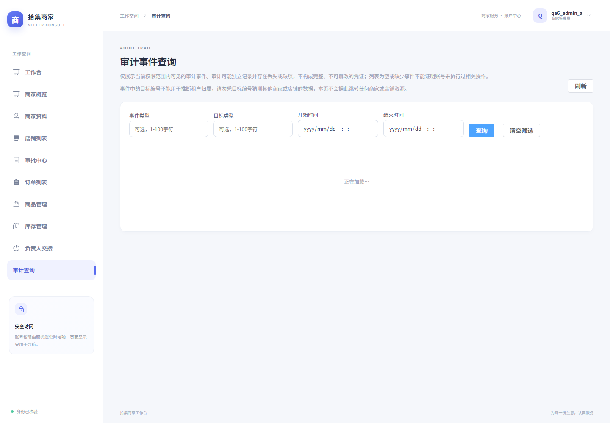
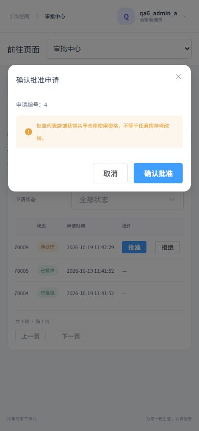

# ECommerce Seller Side：多商家多店铺 SaaS 电商管理平台

## 1. 项目定位与当前边界

本仓库是电商商家端的全栈作品集项目，由 FastAPI 后端与 Vue 3 前端组成，覆盖商品/SPU/SKU、库存、订单、审批与审计等商家侧核心流程。

**当前真实状态（请勿夸大）**：

- 后端：FastAPI 单体，分层为 Router → Service → ORM（同步 SQLAlchemy），共 20 张业务表、46 个业务 API + 1 个 `health`。迁移为 Alembic（`20261017_phase12`）。
- 前端：Vue 3 + TypeScript + Vite + Pinia + Router + Element Plus + Axios。
- 已完成第 6 阶段；前端 lint / typecheck / build、Vitest 均已在本机验证（最终 179 项 Vitest 通过；后端完整 110 项通过，细节见阶段报告）。
- 后端在 Windows（Python 3.12）上对真实 MySQL 完成全量测试并通过；首次受限账号运行的历史失败原因与后续受控处理见《部署 README》。
- **未经生产验收**：Docker 与 Nginx 未在本机/WSL 验证；MySQL 8.4 与容器启动链路、生产 Linux 链路尚未验收。MySQL 8.4 是**目标配置**，不是已通过。**本项目不宣称生产级**，也不覆盖真实支付、物流与高并发场景。

## 2. 架构概览

```
浏览器 → nginx(仅 127.0.0.1:8080) → 前端静态资源 / /api 原样反代 → backend(FastAPI)
                                                              ├─ Service 层业务与事务
                                                              └─ ORM → MySQL 8.4
迁移：migrate 容器（Alembic）一次性任务，backend 等待其完成
```

- 单体后端直接访问 MySQL；同步 ORM 保持事务语义简单可控。
- 前端只调用后端 API，鉴权与权限以**后端 scope 为权威**，前端隐藏入口只是体验优化。
- 平台管理员**没有普通前端后台入口**，仅通过受控 CLI/API 操作。

## 3. 核心实体关系（简化）

- 用户 `user` — 角色**不做永久字符串缓存**：每次请求实时由 DB 推导角色，JWT `sub` 只携带 userid。
- 商家/店铺：用户提交商家申请 → 平台审批 → 成为商家（获得默认仓库）；开店申请 → 商家审批 → 获得默认岗位（**不自动获得仓库权限**）。
- 员工：入职由店主审批；店铺负责人可创建员工岗位，但**岗位不改变权限**（权限由系统 scope 决定）。
- 仓库授权：由商家审批。
- 商品体系：分类 / SPU / SKU 由商家共用；库存对 SKU 记录。
- 订单归属店铺，含历史快照：金额使用 Decimal/DECIMAL 并以字符串返回，主键使用 BIGINT，前端精确解析和序列化 JSON，避免浮点误差。
- 审计：独立提交（业务事务提交后另起 session 写审计），**审计日志可能丢失但不回滚已成功的业务**。

## 4. 角色与关键流程

角色互斥、实时推导。主要流程：

1. **注册商家**：普通注册 → 商家申请 → 平台审批 → 默认仓库。
2. **开店**：开店申请 → 商家审批 → 默认岗位（无自动仓库权）。
3. **员工入职**：申请 → 店主审批。
4. **仓库授权**：商家审批。
5. **订单**：店主与员工可处理**同店**订单；商家对订单**只读**；平台侧无普通前端入口，仅受控 CLI/API。
6. **审批/库存**：平台审核商家入驻与下架申请；商家管理员审核开店和仓库授权、维护商品和人工库存；店主审核员工。

## 5. 业务事务与幂等

- 订单创建时**立即扣减库存**；完成时**不再扣减**；取消时**仅回补 1 次**。
- 库存**人工调整必须幂等**（防重复提交造成二次扣减/回补）。
- 金额在 MySQL 中用 DECIMAL 存储、Python 中用 Decimal 运算、API 中以十进制字符串返回，精度可控。
- 审计写失败不影响业务成功，但需接受日志缺失风险。

## 6. 演示路线

1. 启动服务（见部署 README），访问 `http://127.0.0.1:8080`。
2. 注册普通账号 → 提交商家申请 → 先通过受控 CLI 初始化平台管理员，再使用受保护的审核 API 批准申请（见后端 README）。
3. 使用另一个 NONE 账号申请开店，由商家管理员批准；员工再以 NONE 账号申请加入，由店主批准；仓库授权由店主申请、商家管理员审核。
4. 维护分类 / SPU / SKU 与库存，创建订单并演示扣减、完成、取消回补。
5. 打开审计页：`/merchant/audit`、`/shop/audit`（员工、NONE 与平台管理员均无此前端入口）。
6. 截图：
   - 阶段 5 订单完成：`Frontend/docs/phase5-order-completed.png`
   - 阶段 6 商家审计（1440 宽）：`Frontend/docs/phase6/merchant-audit-1440.png`

## 7. 真实边界与已知风险

- Docker / Nginx 命令不在本机与 WSL，相关链路未验收；MySQL 8.4 容器链路未验证。
- 时间使用 naive 本地时间（目标部署中 DB 与后端 TZ 均配置为 Asia/Shanghai），非 UTC 存储。
- 前端 JWT 存于 sessionStorage，存在 XSS 风险；CSP 文本插值不能绝对防护，**请勿夸大安全等级**。
- 后端依赖范围未完全锁定，全 transitive 可复现性存在风险。
- 无真实支付、物流；不宣称高并发能力。
- **历史测试说明**：初期限受限账号运行出现 3 个 MySQL 1419 触发器相关失败；后在受控管理员连接下**仅对临时库**跑全量并通过，未提升 app 权限、未更改全局配置。
- Node 版本符合 `package.json` engines（>=24.12 / >=11）。

## 8. 文档链接

- 阶段详细说明：`Frontend/README.md`
- 后端说明：`backend/README.md`
- 部署与运维：`deploy/README.md`
- Compose：`deploy/compose.yaml`；Nginx：`Frontend/nginx.conf`


## 本机开发启动

本机验收采用 Python 3.12.14、Node 24.16.0/npm 12.0.1、独立 MySQL 9.7.2。下列命令是本机演示方法，MySQL 必须提前配置本项目专用数据库，不覆盖已有 `.env`，不清空业务数据。

```powershell
cd backend
# 首次安装：用 Python 3.12 建立 .venv，再安装项目已声明依赖
# 已有 .venv 时不要覆盖；先检查解释器，本次 QA 另建 .venv312
py -3.12 -m venv .venv
.venv/Scripts/python.exe -m pip install -e ".[dev]"
# 在本地 .env 填写数据库连接与长随机 JWT 密钥，参照 .env.example
# 对已有库先备份；只在本项目专用库升级，绝不对旧项目库执行
.venv/Scripts/python.exe -m alembic upgrade head
.venv/Scripts/python.exe -m uvicorn app.main:app --host 127.0.0.1 --port 8000
```

另一个终端：

```powershell
cd Frontend
npm ci
npm run dev
```

访问 Vite 显示的本机地址；开发 `/api` 由 Vite 转发到 8000。生产构建只使用相对 `/api/v1`，由 Nginx 反向代理，不依赖 Vite proxy。健康接口仅证明进程存活。

- [最终验收矩阵](docs/ACCEPTANCE.md)
- [前端第六阶段与具体文件清单](Frontend/README.md)


## 演示截图

商家审计查询（第六阶段）：



移动端仓库授权确认（第六阶段）：


